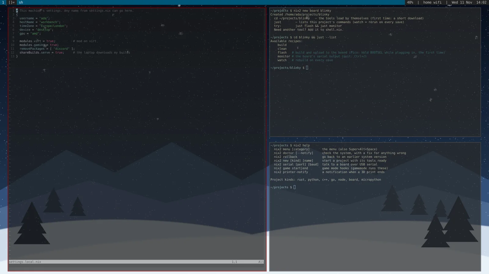

# nix²

**A Linux for people who build things.** Write code, design circuit boards,
flash microcontrollers, 3D print, game — on a fast, private desktop that
sets itself up. Built on [NixOS](https://nixos.org), so the whole system is
a few readable files: nothing breaks for good (every update can be rolled
back), and every feature is a module you switch on with one command.



```sh
mod list          # what's on and off
mod on virt       # switch a module on (it rebuilds for you)
```

- **One menu for everything** — Super+Alt+Space. Every feature lives there;
  Super+Alt+F1 lists your keys.
- **Hardware just works** — plug in an Arduino, ESP32, Raspberry Pi Pico, debug
  probe, logic analyser or QMK/Vial keyboard and it's usable straight away, no
  sudo. `nix2 serial` shows a board's output; `nix2 new board` starts a
  PlatformIO project you build and flash with `just flash`. KiCad, FreeCAD,
  OpenSCAD and OrcaSlicer are in.
- **Coding without setup** — `nix2 new` makes a Rust / Python / C++ / Go /
  Node project whose compiler, language server and formatter load when you
  `cd` in. Builds are fast by default: a compile cache (sccache/ccache) and the
  mold linker for every project, and a notification when a long build ends.
  `pip install` works like on any other Linux (into your home folder, wheels
  like numpy and OpenCV included); pipx and uv are there too.
- **Your machines help each other** — one computer can share what it built
  with your others over your home network, so they download instead of
  compiling.
- **Looks after itself** — `nix2 doctor` checks the things that usually
  break (audio, screenshots, graphics drivers, disk, backups, battery…) and
  tells you the fix; a weekly check only speaks up when something's wrong.
  Updates are pre-built in the background, and `nix2 rollback` undoes one.
- **Private by default** — firewall on, SSH off, Tor one command away
  (`tormode on`), Proton VPN, Bitwarden, encrypted disk from the installer.
- **Games** — Steam with Proton for every game, controllers, and a game mode
  that pauses notifications and the live wallpaper while you play.

## Install

**New computer (or one you're happy to wipe): the installer USB.**

1. Download `nix2-installer.iso` from the
   [latest release](https://github.com/bnvac/nixosconfig/releases/latest).
2. Write it to a USB stick (4 GB+) with [balenaEtcher](https://etcher.balena.io)
   or Ventoy, or `sudo dd if=nix2-installer.iso of=/dev/sdX bs=4M status=progress`.
3. Boot from the stick (UEFI mode; turn off Secure Boot) and type
   `nix2-install`. It connects to Wi-Fi, asks which disk to use (and erases
   it), whether to encrypt it, and a few questions about you. Then it installs
   — about 15–40 minutes, depending on your internet.

**Already running NixOS:**

```sh
sudo mv /etc/nixos /etc/nixos.orig
sudo git clone https://github.com/bnvac/nixosconfig /etc/nixos
sudo cp /etc/nixos.orig/hardware-configuration.nix /etc/nixos/
sudo bash /etc/nixos/pkgs/scripts/setup.sh     # you, hostname, timezone, laptop/desktop, graphics
sudo nixos-rebuild switch
```

Then log in and press **Super+Alt+Space**. `modtui` walks you through the rest
(modules, an AI model, linking a second machine).

**Hardware:** any x86-64 PC from roughly the last ten years. Graphics: AMD and
Intel work out of the box; NVIDIA gets NVIDIA's own driver
(`gpu = "nvidia"` — the installer picks it for you). Laptops get battery and
thermal tuning.

## Your settings

`settings.nix` lists every setting with its default and what it does — don't
edit it. **Your** values go in `settings.local.nix` next to it: the installer
writes it, it's not in git, so updates never touch it.

```nix
{
  username = "ada";
  gpu = "nvidia";
  liveSnow = false;
  modules.gaming = false;          # mod off gaming does this for you
  removePackages = [ "discord" ];  # debloat remove discord does this for you
}
```

`rebuild` applies changes. `nixup` pulls the newest nix² and rebuilds.

## Modules

On by default unless it says otherwise. `mod on <name>` / `mod off <name>`.

| module | what |
|---|---|
| desktop | dwm/st/dmenu/dwmblocks (based on LARBS), picom, snowy live wallpaper, lock screen, Thunar + drives, apps menu, Bluetooth, clipboard history, night light |
| devtools | coding toolkit: lazygit, gh/glab/tea, delta, difftastic, direnv, just, hyperfine, CMake/Ninja/clangd/gdb/valgrind, Meld, Zeal, Qalculate; sccache/ccache + mold for fast builds; `nix2 new`; shared builds. `devExtras = true` adds VSCodium, Helix, Ghidra, Octave, OBS |
| ee | hardware & electronics: KiCad, ngspice, PulseView/sigrok, PlatformIO, Arduino IDE, picotool, esptool/espflash, probe-rs, OpenOCD, ST-Link, dfu-util, Thonny/mpremote, QMK + Vial, FreeCAD, OpenSCAD, OrcaSlicer — and the device permissions for all of it |
| apps | LibreOffice, browsers (+ Bitwarden), Discord/Slack, media, Calibre, torrents + Stremio, Onshape |
| gaming | native Steam with Steam Play for every game, Proton-GE, NTSYNC, gamescope/gamemode, Xbox controllers, Prism Launcher |
| privacy | Tor (Tor Browser, per-app, system-wide — off until you turn it on), Proton VPN, I2P, Bitwarden, nheko |
| platform | Docker, Flatpak/Flathub, AppImage, Distrobox, and apps built from any git repo (`gitApps`) |
| printing | mDNS + printrun for Klipper printers on the network; a notification when a print ends |
| backups | daily restic snapshots of home + config to an external drive |
| power | laptop battery/thermal tuning (TLP); does nearly nothing on a desktop |
| virt | QEMU/KVM + virt-manager — **off by default** |
| sync | two machines: Syncthing, DeviceLink (send files, tabs, screen), bookmarks — **off by default** |
| ai | Claude Code — **off by default** |
| assistant | Neb, a local voice assistant, + Ollama / Open-WebUI on your GPU — **off by default** |
| backoffice | a parts-inventory web app — **off by default** |
| intraweb | a local-first neighborhood web on your LAN (no server, no internet) — **off by default** |
| slowtyper | SlowTyper: types the clipboard (or any text) into the focused window at a human pace, from the menu — **off by default** |
| secrets | passwords/keys encrypted in git with sops-nix — **off by default** |
| osint | security / OSINT toolkit — **off by default** |

## Commands

| command | what |
|---|---|
| `modtui` | TUI: onboarding, modules, settings, AI model (with download bar), update |
| `nix2-setup` | this machine's settings (you, hostname, timezone, laptop/desktop, graphics) → `settings.local.nix`; `nix2-setup set KEY VALUE` changes one |
| `rebuild` (`nrs`) | apply your config + update your own git apps (seconds when nothing is new), live progress bar. `--upgrade` also moves to the newest NixOS packages — normally pre-built for you weekly in the background; `--no-update` just applies config |
| `update-mine` | move your git-built apps (neb, backoffice, intraweb, slowtyper + `gitApps`) to their latest commit, only if it builds; runs daily too. `--status` to just look |
| `debloat` | what's using space, and clean it; `debloat junk` finds old build folders (target/, node_modules/…) in projects you haven't touched for a month; `debloat remove <app>` drops an app from every module, or uninstalls a Flatpak by id (`org.gimp.GIMP`) and trims runtimes nothing else uses |
| `nixup` | update /etc/nixos from git + rebuild (`autoUpdate = true` does it weekly). Your own edits there are kept: committed locally first and put back on top of the update; if one clashes, nothing changes and it names the file. `nix2-pull --mine` lists them |
| `nix2 doctor` | system check: failed services, disk, memory, clock, network, screenshots, audio, Vulkan/Steam libraries, updates, backups, battery health, temperature — each problem with its fix. Menu: System → System check; runs weekly and notifies only if something's wrong |
| `nix2 rollback` | go back to an earlier system version if an update broke something (Enter = the one before); menu: System → Roll back |
| `nix2 new` | start a project in `~/projects` with its tools ready — Rust, Python, C/C++, Go, Node, a microcontroller board (PlatformIO: Pico, ESP32, Arduino) or MicroPython: shell.nix + direnv + git + `just` commands (`just watch` reruns on every save, `just flash` for boards) |
| `nix2 serial` | pick a plugged-in board by name and see its serial output (reconnects when you reflash) |
| `nixmenu` | this system's actions by category — **Super+Alt+Space** (Backspace = back, Esc = close). Add/hide/reorder with `menu` in your settings, or `~/.config/nixmenu/menu` (no rebuild) |
| `mykeys` | your keybind cheat sheet — **Super+Alt+F1** |
| `apps` | every app, by category — **Super+Alt+a** |
| `audio` | pick output/mic device (speakers, headset, Bluetooth, HDMI), volume, mute — **Super+Alt+v** |
| `drives` | mount / unlock / unmount drives, never automatic — **Super+Alt+m** |
| `tidy` | clean up: loose files in your home folder go to Pictures / Videos / Music / Documents (screenshots and recordings get their own folders), the rest to Downloads, which is sorted into type folders; catches duplicates, never deletes, `--undo` (`--home`, `--downloads`, `--dry-run`) |
| `screenshot` | **Print** = whole screen, **Shift+Print** (or **Super+Alt+s**) = area / window / clipboard / text (OCR); saved to `~/Pictures/screenshots` and copied to the clipboard |
| `lock` | lock screen: just your username + password — **Super+Alt+l** (also on suspend / 10 idle min) |
| `site-push` | publish a folder to its Neocities site — menu: Apps & files → "Publish a folder to Neocities". The site comes from the repo's `.neocities` file; only changed files upload |
| `wallpapers` | the wallpaper picker — six built-in wallpapers (snowy night, aurora, dusk ridge, blueprint, topography, circuit board), your pictures, or live **Wallpaper Engine** ones from the Steam Workshop; fit, shuffle, snow on/off — **Super+Alt+w** |
| `neofetch` / `fastfetch` | system summary with nix²'s layout (version you can roll back from, modules on); your own `~/.config/fastfetch/config.jsonc` takes over — **Super+Alt+i** |
| `snow on\|off` | the live falling snow (never piles up) |
| `clipmenu` | clipboard history — **Super+Alt+c** |
| `nightlight` | night light on/off for now (warmer screen after sunset; `nix2-setup` sets where you are from your timezone) |
| `steam-setup` | turns on Steam Play for all games (runs at login; Steam must be closed) |
| `thunar` | GUI file manager — **Super+Alt+e** (`lf` is still Super+r) |
| `dash` | the menu's Self-hosted section (your web apps + running Docker containers) — **Super+Alt+d** |
| `neb-voice` | talk to Neb, answer in a corner notification — **Super+Alt+n** |
| `neb-space` | Neb's workspace (tag 9) + his terminal — **Super+Alt+Shift+n** |
| `devlink …` | `pin` to pair, `send`, `tabs` (your browser tabs → the other machine), `screen` / `view` |
| `backoffice-sync` | inventory hand-off between machines (`--status`) |
| `browser-sync` | export bookmarks to ~/Sync + merge the other machine's back (runs at login too) |
| `browser-sync passwords` | push each browser's own password export into Bitwarden |
| `torrun <app>` / `tormode on\|off\|status` | one app / everything through Tor (`status` proves it via check.torproject.org) |
| `protonvpn-app` / `protonvpn` | Proton VPN (app / CLI) |
| `backoffice` | parts-inventory web app on :8080 |
| `intraweb` | neighborhood web on the LAN; dashboard on :8420 (runs at login) |
| `backup` | restic snapshot to the external drive; `backup now`, `backup snapshots`, `backup restore …` |

## Notes

- **Speed & space**: zen kernel (`settings.kernel`), compressed RAM swap, and
  automatic de-prioritising of background work keep it snappy; no HTML docs
  are built, the journal is capped, old generations go after 14 days. Every
  module installs through one list, so `removePackages = [ "discord" ];` (or
  `debloat remove discord`) drops an app everywhere.
- **Your apps from git**: add `name = { repo = "owner/repo"; type = "rust"; };`
  (or `url = "https://…"` for any git server) under `gitApps` in `settings.local.nix`.
  Types: rust, go, node, python, make, script, docker. `update-mine` keeps them
  on their newest commit and only switches to one that builds. The same works
  to point neb/backoffice/intraweb at a fork. Forking this whole config? Clone
  your fork to /etc/nixos and `nixup` pulls from it.
- **Tor**: `tormode on` waits until Tor has connected and shows the exit IP.
  While it's on, anything that can't go through Tor — IPv6, QUIC, your LAN,
  Docker, a VPN — is refused instantly instead of leaking or hanging.
- **Proton VPN**: open it from the menu (Network & privacy) and sign in once;
  the login is kept in your keyring, which unlocks when you log in. Turn the
  VPN off before `tormode on`.

- **Keys**: Super+Enter is the terminal and Super+Space is stock again; everything
  of yours is under Super+Alt (`mykeys` lists it).
- **Neb** (`mod on assistant`): on a desktop with a GPU his brain is Ollama on
  the GPU — Vulkan on AMD/Intel (ROCm skips many Radeon cards and silently falls
  back to the CPU), CUDA on NVIDIA; laptops use an API key. Default model
  `qwen3.5:9b` with thinking off; `modtui` → AI model to pick another. He can act
  on the desktop through `desk`; typing, keys and closing windows ask first.
- **Passwords/bookmarks**: Bitwarden is pre-installed in Firefox and Chromium —
  sign in once per browser; it's the password vault and syncs itself. Bookmarks
  move with `browser-sync`: no live sync service, it just exports them to an
  HTML file in `~/Sync` (Syncthing carries it over) and merges the other
  machine's file back, at login and whenever you run it. To pull in your
  browser-saved passwords, export them from each browser's own Passwords screen
  and run `browser-sync passwords` — it imports the CSV into Bitwarden and
  shreds it. It never touches a browser's encrypted password store itself, and
  no password ever lands in the Sync folder.
- **Neighborhood (intraweb)**: joins the LAN's neighborhood web at login — a
  dashboard on `:8420`, with pages, files, signed mail and channels, no server
  and no internet. Your identity is a key in `~/.intraweb`; copy that folder to
  stay yourself on another machine. nixmenu → **Neighborhood** opens it. To host
  a hub (claims `intranet.local`), run `sudo intraweb up --hub` by hand.
- **Backups**: the `backups` module takes daily restic snapshots of `~` and
  `/etc/nixos` to the drive at `backupRepo` (settings). Set it up once — plug in
  the drive, put a passphrase in `~/.config/restic/password` (or use the
  `secrets` module), run `backup now`. It skips quietly with a reminder when the
  drive isn't plugged in, so the daily timer never nags with failures. **Keep a
  copy of the passphrase** — without it the backup can't be restored.
- **Secrets**: off by default. `mod on secrets` sets up sops-nix so passwords
  and keys live encrypted in `secrets/` (safe to commit) and decrypt to
  `/run/secrets/*` with a machine-local age key that never enters git. See
  `secrets/README.md`.
- **Power (laptop)**: the `power` module runs TLP — powersave governor on
  battery, performance on AC, USB autosuspend. On the desktop it does almost
  nothing. `powertop` is there for a look at what's drawing power.
- **3D printers**: list your printers' Moonraker URLs in `settings.printers` and
  you get a desktop notification when a print finishes or fails.
- **Drives**: nothing mounts by itself. `drives`, or click the drive in Thunar's
  sidebar — both use udisks2 as you (no sudo), mount under
  `/run/media/<your user>/<label>`, and handle LUKS. Phones show up in Thunar.
- **Top bar**: clock + net/volume/battery — `pkgs/default.nix` → `larbs-dwmblocks`.
- **Terminal transparency**: `termOpacity` in settings; fullscreen is always opaque.
- **Minecraft**: Prism Launcher; Feather/Fabric install into it from Modrinth.
- **Neocities**: menu → Apps & files → "Publish a folder to Neocities" (or
  `site-push [folder]`). Pick a folder; the first time, say which site and
  which subfolder is the website — that's saved in a `.neocities` file at the
  repo root (commit it; no secrets), so next time it just goes. Paste the
  site's API key once (neocities.org → Settings → your site → API key); it's
  kept in your keyring and checked against the site before every upload, so
  a folder can't end up on the wrong site. Optional `build = "…"` runs first.
  `--dry-run` previews, `--prune` also removes files you deleted locally.
- **Wallpaper Engine**: own it on Steam and install it (Steam Play is already
  on, so Steam will install the Windows app — you never run it), subscribe to
  wallpapers in the Workshop, then pick them in `wallpapers` → Wallpaper Engine.
  They play on every screen, muted, at 30 fps, and pause while a game is
  fullscreen. Picking a picture switches the live one off.
- **Wallpaper**: a snowy night with live snow by default; `setbg /path/to/image.png`
  to change it, `snow off` (or `liveSnow = false`) to stop the snow.

## How it's put together

```
configuration.nix     imports core + every module that's on
picker.nix            which modules exist / are on (mods/ + your settings)
settings.nix          every setting, its default and what it does
settings.local.nix    YOUR machine's values (not in git; nix2-setup writes it)
options.nix           shared options modules fill in (menu entries, packages…)
modules/core.nix      always on: boot, network, user, audio, shell, updates
modules/*.nix         one feature each (table above)
mods/<name>           an empty file = that module is on by default
pkgs/default.nix      everything built from source (dwm/st/dmenu, nix2, …)
pkgs/nix2/          `nix2`: menu, doctor, rollback, game mode, new,
                      serial, printer alerts — one small Rust program
pkgs/scripts/         the smaller tools (rebuild, setup, debloat, screenshot…)
pkgs/tracked.nix      which commit every git-built app uses
installer/            the installer USB (iso.nix) and nix2-install
ci/                   stand-ins CI uses to check the config builds
```

## Contributing

Ideas, bug reports and pull requests are welcome — see
[CONTRIBUTING.md](CONTRIBUTING.md). Every pull request is checked
automatically: the config must evaluate for an AMD desktop, an Intel laptop
and an NVIDIA desktop, nix2's tests must pass, and every script must pass
shellcheck.

## Website

`site/` is the homepage. GitHub publishes it with Pages on every change
(`.github/workflows/site.yml`; turn it on once under Settings → Pages →
Source: GitHub Actions).

## Credits & license

nix² is MIT-licensed ([LICENSE](LICENSE)). The desktop is built on Luke
Smith's [LARBS](https://larbs.xyz) builds of the suckless tools
(dwm, st, dmenu), and on [NixOS](https://nixos.org) and nixpkgs. nix² is an
independent project, not affiliated with the NixOS Foundation.
